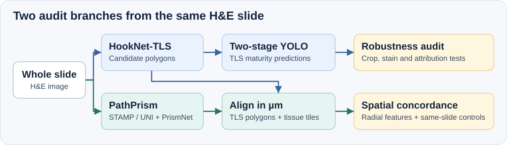

# Trustworthy TLS Pathology Audit

**A six-week research prototype for asking when a multi-model pathology
prediction deserves to be trusted.**

> Status: engineering and hypothesis-generation study
>
> Data: ten public TCGA-STAD whole-slide images
>
> Ground truth: no object-level pathology ground truth
>
> Intended use: research only; not for diagnosis or clinical decision-making

## Why this project

I began with a conventional question: could a released pipeline classify the
maturity of tertiary lymphoid structures (TLS) in H&E whole-slide images?
After reconstructing the workflow, a more important question emerged:

> Are its predictions stable, spatially plausible and supported by the image
> region that the model is supposed to evaluate?

The project therefore shifted from optimizing a classifier to auditing an
entire evidence chain. The central contribution is not a new TLS detector or a
validated biological biomarker. It is a reproducible framework for identifying
context sensitivity, preprocessing sensitivity, coordinate failures and
evidence-localization failures before a model output is treated as a result.

## What I built

The workflow joins three released systems at different spatial levels:

1. **HookNet-TLS** supplies model-generated candidate polygons.
2. A released **YOLO maturity cascade** assigns working E/P/S labels.
3. **PathPrism**, using STAMP/UNI features and PrismNet, maps the surrounding
   tissue into eight biological tissue classes plus BACK.

I added:

- physical-coordinate alignment between WSI polygons and semantic tiles;
- crop-context perturbations from 0% to 40% padding;
- colour, encoding and stain-normalization stress tests;
- Grad-CAM, occlusion and blurred counterfactual analyses;
- radial tissue features and three same-slide matched controls per candidate;
- slide-level summaries that avoid treating multiple objects as patients;
- explicit uncertainty and manual-review queues.

## Compact results

| Audit question | Descriptive result | Interpretation |
|---|---:|---|
| Candidate set | 84 model-generated candidates from 8 detected slides; 10 slides screened | Pilot audit set, not a pathology cohort |
| Context robustness | Hard-cascade label stable for 41/84 across 0–40% padding | Nearly half changed under crop context |
| Mild technical perturbations | 10/84 changed under at least one mild colour or encoding variant | Non-trivial deployment sensitivity |
| Macenko normalization | 48/84 labels changed | Normalization cannot be inserted without calibration |
| Evidence localization | Step-1 / Step-2 Grad-CAM enrichment above one: 75/84 / 20/84 | Step 2 often used substantial non-polygon context |
| Tissue-context consistency | Inner LYM paired effect positive in 8/8 detected slides | Same-H&E cross-model concordance only |

The mean of the eight slide-level PathPrism paired effects was +0.4164
LYM-fraction units. The exploratory slide-cluster bootstrap interval was
[+0.2302, +0.6018]. This is intentionally described as spatial concordance:
both candidate detection and tissue semantics were inferred from the same H&E
source.

## What this study does not establish

- It does not establish whether a candidate is a true TLS.
- It does not validate E/P/S maturity against an expert reference.
- It does not provide sensitivity, specificity, accuracy or clinical utility.
- PathPrism LYM is a predicted tissue class, not a cell count.
- Grad-CAM and counterfactual perturbations describe model dependence, not
  biological causality.
- Eight detected slides are insufficient for generalization or outcome claims.

See [Limitations](docs/limitations.md) for the full interpretation boundary.

## Repository layout

~~~text
src/tls_audit/       candidate extraction, PrismNet adapter, spatial features,
                     YOLO reliability audit and summary utilities
analysis/            public aggregate-QC and descriptive summary scripts
tests/               dependency-free unit tests and optional spatial checks
data/                public GDC manifest only; no WSI or clinical data
results/             aggregate and anonymized slide-level summaries
figures/             author-generated aggregate figures
docs/                project brief, methods, limitations and reproducibility
~~~

## Quick checks

The dependency-free tests run with the Python standard library:

    python3 -m unittest discover -s tests -p "test_*.py" -v
    python3 analysis/summarize_public_results.py

For the scientific modules:

    python3 -m venv .venv
    source .venv/bin/activate
    pip install -e ".[wsi,models,dev]"
    python tests/synthetic_spatial_checks.py

The full pipeline additionally requires OpenSlide, public GDC slides and
third-party weights obtained directly from their official sources. None is
bundled here.

## Reproducibility scope

This repository supports inspection and testing of the original adapter and
audit code and regeneration of the public aggregate summaries. It is not a
one-command archive of the original compute environment. Exact WSI acquisition,
model access and HPC execution are documented in
[Reproducibility](docs/reproducibility.md).

## Project perspective

The most important outcome was a change in research practice: model agreement
is not ground truth, multiple objects are not multiple patients, and a stable
confidence score can still be attached to the wrong evidence. Negative and
No-Go results were retained because they determined which claims should stop.

The next defensible step is a small, blinded pathology review and external
validation on data with an independent biological measurement.

## Attribution and license

Original code is MIT-licensed. Every external model, checkpoint and dataset
retains its own terms; see [Third-party notices](THIRD_PARTY_NOTICES.md).
