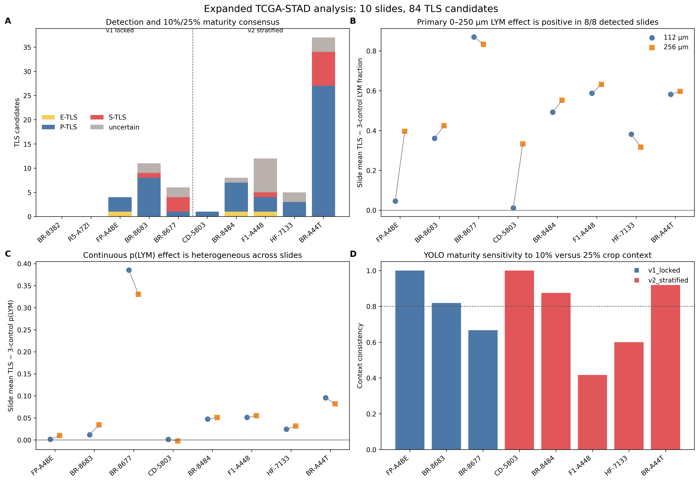
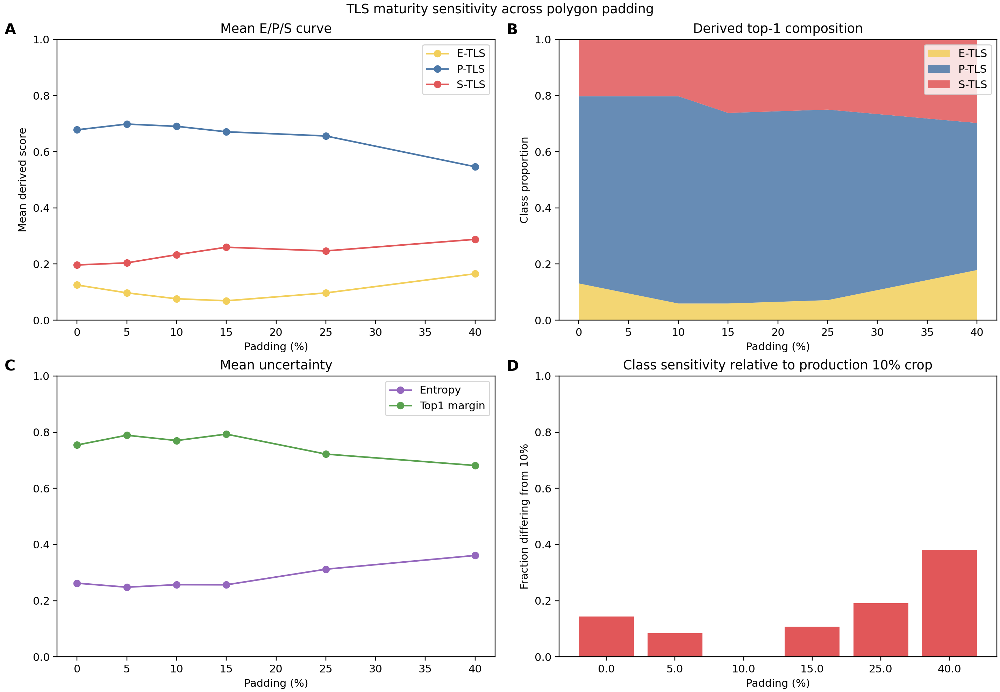

# Trustworthy TLS Pathology Audit

A reliability audit of tertiary lymphoid structure (TLS) predictions on 10 public TCGA-STAD whole-slide H&E images.


- **Model integration.** HookNet-TLS proposes candidate polygons, a two-stage YOLO cascade predicts maturity, and PathPrism (STAMP/UNI + PrismNet) maps the surrounding tissue.
- **Coordinate alignment.** I map whole-slide polygons and tissue tiles to a common micrometre coordinate system, then extract radial features and select three matched regions per candidate on the same slide. [Spatial analysis code](src/tls_audit/spatial_features.py)
- **Prediction stability.** Across six crop paddings from 0% to 40%, **43 of 84** model-generated candidates changed their final YOLO label at least once. [Audit code](src/tls_audit/yolo_robustness.py) · [Aggregate counts](results/aggregate_summary.json)
- **Spatial concordance.** Within 250 µm of candidate centres, the predicted lymphoid tissue fraction was higher than in matched regions on **all 8 slides with detections**, with a mean slide-level difference of **+41.6 percentage points**. Both models used the same H&E images. [Slide-level results](results/pathprism_slide_effects.tsv)
- **Related GigaTIME pilot.** In a separate TCGA-STAD experiment, I aligned GigaTIME's H&E-derived virtual immunofluorescence features with YOLO maturity predictions and PathPrism tissue features around the same TLS candidates. [Upstream GigaTIME model](https://github.com/prov-gigatime/GigaTIME)

## Audit results

| Check | Result |
|---|---|
| Candidate coverage | 84 model-generated candidates on 8 of 10 screened slides |
| Crop context | 43/84 changed final YOLO cascade labels across the six padding settings |
| Mild colour or encoding perturbations | 10/84 changed predicted class under at least one variant |
| Macenko stain normalization | 48/84 changed predicted class |
| Grad-CAM localization | 75/84 stage-1 and 20/84 stage-2 maps had above-area-baseline saliency inside the candidate polygon |
| PathPrism spatial concordance | Mean paired lymphoid tissue fraction difference of +0.4164 across 8 slide-level means. Exploratory slide-cluster bootstrap 95% interval [0.2302, 0.6018] |

[Methods](docs/methods.md) · [Machine-readable summary](results/aggregate_summary.json)





The candidate and tissue labels are model outputs from the same H&E images. The spatial result measures cross-model concordance in this pilot. TLS identity, maturity and clinical performance require independent validation. [Limitations](docs/limitations.md)

## Quick checks

Run the standard-library tests and verify the anonymized slide-level summary.

```sh
python3 -m unittest discover -s tests -p 'test_*.py' -v
python3 analysis/summarize_public_results.py
```

To run the synthetic checks for coordinates, boundaries and matched controls, install the scientific dependencies first.

```sh
python3 -m venv .venv
source .venv/bin/activate
pip install -e '.[wsi,models,dev]'
python tests/synthetic_spatial_checks.py
```

The full audit also requires OpenSlide, public GDC slides and third-party weights obtained from their official sources. [Reproducibility guide](docs/reproducibility.md)

## Repository layout

| Path | Contents |
|---|---|
| [`src/tls_audit/`](src/tls_audit) | Candidate extraction, PrismNet adapter, spatial features and YOLO audits |
| [`analysis/`](analysis) | Public aggregate QC and summary scripts |
| [`tests/`](tests) | Standard-library tests and synthetic spatial checks |
| [`data/`](data) | Public GDC manifest |
| [`results/`](results) | Aggregate and anonymized slide-level results |
| [`docs/`](docs) | Methods, limitations and reproduction instructions |

## Attribution and license

Original code is MIT-licensed. External models, checkpoints and datasets retain their own terms. [Third-party notices](THIRD_PARTY_NOTICES.md)
